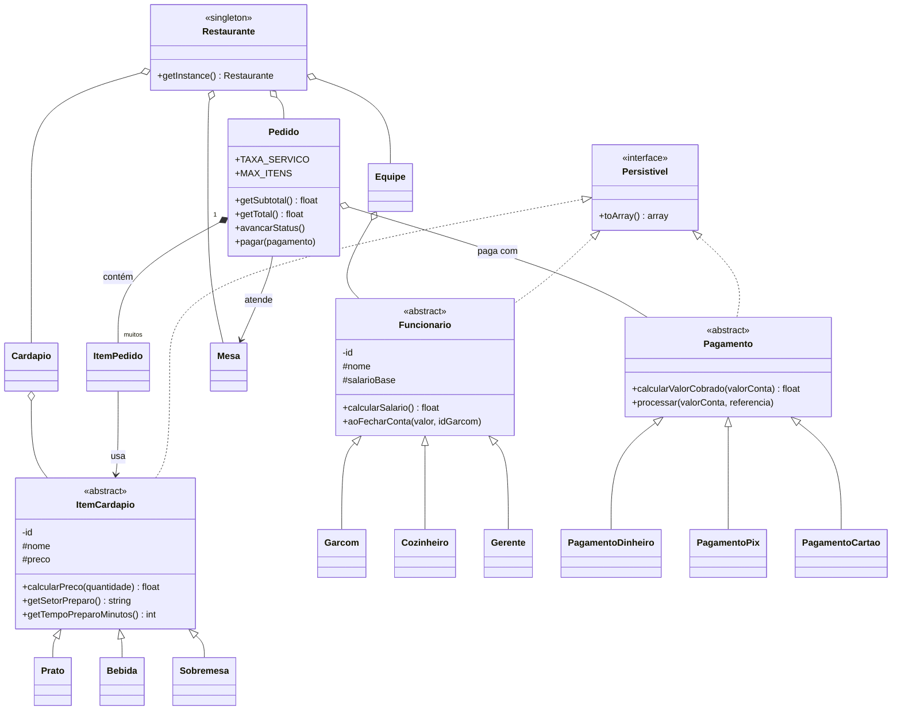

# Planejamento — Sistema de Gerenciamento de Restaurante

> Documento do **item 3 do enunciado** ("Planejamento antes de codar"). Foi feito antes de abrir o
> editor e responde, uma a uma, às cinco perguntas pedidas. Os itens 6 a 9 acrescentam o que o grupo
> decidiu para constar na implementação e na divisão de trabalho.

| | |
|---|---|
| **Disciplina** | Programação Orientada a Objetos — 2º ADS 2026-2 (IFRO) |
| **Tema** | Sistema de Gerenciamento de Restaurante |
| **Grupo** | Erik Carvalho Nogueira · Felipe Ferreira Rosas · Danilo Sales Coutinho |
| **Tecnologia** | PHP 7.4+ (testado no PHP 8.2 do XAMPP), POO pura, sem framework e sem banco de dados |
| **Persistência** | arquivo JSON em `data/` (criado sozinho na primeira execução, já com dados de exemplo) |

**Por que JSON e não MySQL?** Para o sistema subir no XAMPP só copiando a pasta e iniciando o Apache:
sem importar banco, sem senha, sem porta. O foco do trabalho é a orientação a objetos, não o banco.

## 0. O sistema em poucas palavras

O restaurante tem um **cardápio** (pratos, bebidas e sobremesas), uma **equipe** (garçons, cozinheiros e
gerente), **mesas** e **pedidos**. O garçom abre uma mesa, lança os itens e o pedido avança pela cozinha
(aberto → em preparo → pronto → entregue). No fim a conta é paga em dinheiro, Pix ou cartão. O sistema
calcula preços, taxa de serviço, folha de pagamento e faturamento.

## 1. Quais são as "coisas" do sistema que viram classes?

| Classe | O que representa | Responsável |
|---|---|---|
| `ItemCardapio` *(abstrata)* | qualquer coisa vendida no restaurante | Erik |
| `Prato`, `Bebida`, `Sobremesa` | os tipos de item | Erik |
| `Cardapio` | coleção de itens (busca, cadastro, remoção) | Erik |
| `Funcionario` *(abstrata)* | qualquer pessoa da equipe | Felipe |
| `Garcom`, `Cozinheiro`, `Gerente` | os cargos | Felipe |
| `Equipe` | coleção de funcionários e folha de pagamento | Felipe |
| `Mesa` | mesa do salão (livre, ocupada ou reservada) | Danilo |
| `StatusPedido` | etapas do pedido (aberto → … → pago) | Erik |
| `ItemPedido` | uma linha do pedido (item + quantidade + observação) | Erik |
| `Pedido` | a comanda da mesa; calcula subtotal, taxa de serviço e total | Erik |
| `Pagamento` *(abstrata)* | contrato de uma forma de pagamento | Danilo |
| `PagamentoDinheiro`, `PagamentoPix`, `PagamentoCartao` | as formas de pagar | Danilo |
| `Restaurante` | fachada única do sistema (**Singleton**) | Erik |
| `ArmazenamentoJson` | grava e lê o arquivo JSON | Felipe |
| `DadosExemplo` | dados iniciais do restaurante | Erik |
| `ItemCardapioFactory`, `FuncionarioFactory`, `PagamentoFactory` | criam o objeto certo a partir de um texto (**Factory**) | Erik, Felipe, Danilo |
| `Config`, `Util` | configuração fixa e utilitários estáticos | Erik |
| `Persistivel` *(interface)* | contrato "sei me converter em array para gravar em JSON" | Erik |
| `RestauranteException` + 7 específicas | exceções próprias do sistema | autor de cada módulo |

## 2. Existe uma classe genérica da qual outras são especializações? (herança)

```
ItemCardapio (abstrata) ─┬─ Prato
                         ├─ Bebida
                         └─ Sobremesa

Funcionario (abstrata) ──┬─ Garcom
                         ├─ Cozinheiro
                         └─ Gerente

Pagamento (abstrata) ────┬─ PagamentoDinheiro
                         ├─ PagamentoPix
                         └─ PagamentoCartao

Exception ── RestauranteException ──┬─ DadosInvalidosException
                                    ├─ ItemNaoEncontradoException
                                    ├─ FuncionarioNaoEncontradoException
                                    ├─ MesaIndisponivelException
                                    ├─ PedidoInvalidoException
                                    ├─ PagamentoInvalidoException
                                    └─ ArmazenamentoException

Persistivel (interface) ◄── ItemCardapio, Funcionario, Pagamento, Cardapio, Equipe, Mesa, Pedido, ItemPedido
```

## 3. Existe um comportamento que muda conforme o tipo, mas é chamado da mesma forma? (polimorfismo)

O código que **usa** o tipo-base nunca pergunta "qual é a subclasse?": só chama o método.

| Chamada feita sobre o tipo-base | Prato / Garçom / Dinheiro | Bebida / Cozinheiro / Pix | Sobremesa / Gerente / Cartão |
|---|---|---|---|
| `ItemCardapio::calcularPreco($qtd)` | preço cheio | 10% de desconto a partir de 6 unidades | leve 3, pague 2 |
| `ItemCardapio::getSetorPreparo()` | Cozinha | Bar | Confeitaria |
| `ItemCardapio::getTempoPreparoMinutos()` | definido no cadastro | 3 min | 8 min |
| `Funcionario::calcularSalario()` | base + 5% das vendas que atendeu | base + horas extras com 50% de adicional | base + 20% se a meta do mês for atingida |
| `Funcionario::aoFecharConta()` | soma a venda se foi o garçom do pedido | não faz nada | soma ao faturamento da equipe |
| `Pagamento::calcularValorCobrado($conta)` | valor integral (exige valor recebido ≥ conta) | 5% de desconto | débito à vista; crédito parcelado com 2% por parcela extra |

**Onde o polimorfismo acontece de verdade** (um `foreach` ou função que recebe o tipo-base):

- `Pedido::getSubtotal()` — percorre as linhas do pedido e chama `ItemCardapio::calcularPreco()` de cada item.
- `Pedido::estimarTempoPreparoMinutos()` e `Pedido::getSetoresEnvolvidos()` — idem, com tempo e setor.
- `Equipe::calcularFolha()` e `Equipe::registrarVenda()` — percorrem `Funcionario[]` chamando `calcularSalario()` / `aoFecharConta()`.
- `Pagamento::processar()` (*Template Method*) e a tabela de simulação de `pagamento.php` — chamam `calcularValorCobrado()` de cada forma de pagamento.
- `Cardapio::descricoes()` — percorre `ItemCardapio[]` chamando `descrever()`.

## 4. Que erro pode acontecer que mereça exceção própria?

Todas herdam de `RestauranteException`, que por sua vez `extends Exception`.

| Exceção | Cenário real | Lançada em | Tratada (try/catch) em |
|---|---|---|---|
| `ItemNaoEncontradoException` | buscar ou remover item do cardápio com código que não existe | `Cardapio::buscarPorId()` | `cardapio.php` (busca por código), `pedido.php`, `demo.php` |
| `FuncionarioNaoEncontradoException` | buscar/demitir funcionário inexistente ou escolher como garçom quem não é garçom | `Equipe::buscarPorId()`, `Equipe::buscarGarcom()` | `funcionarios.php`, `mesas.php`, `helpers.php` |
| `MesaIndisponivelException` | abrir mesa já ocupada, grupo maior que a capacidade, mesa inexistente | `Mesa::ocupar()`, `Mesa::reservar()`, `Restaurante::buscarMesa()` | `mesas.php` |
| `PedidoInvalidoException` | adicionar item a pedido pago/cancelado, quantidade fora do limite, pagar pedido não entregue | métodos de `Pedido`, `Restaurante::buscarPedido()` | `pedido.php`, `pagamento.php` |
| `PagamentoInvalidoException` | dinheiro insuficiente, parcelas inválidas, forma de pagamento desconhecida | `Pagamento::processar()` e subclasses, `PagamentoFactory::criar()` | `pagamento.php` |
| `DadosInvalidosException` | nome vazio, preço fora da faixa, número inválido digitado no formulário | setters e `Util::paraFloat()` / `Util::paraInt()` | páginas com formulário |
| `ArmazenamentoException` | JSON corrompido ou pasta `data/` sem permissão de escrita | `ArmazenamentoJson` | `helpers.php` (`restaurante()` e `executarAcao()`) |

## 5. Quem do grupo vai implementar cada classe?

O Erik fica com o núcleo e com a maior parte do sistema (cardápio, pedidos, Singleton, páginas e testes); o Felipe e o Danilo ficam, cada um, com um módulo completo (contrato → subclasses → polimorfismo → exceção → página).
O nome em cada arquivo está no cabeçalho `Responsável:` — é a fonte da verdade da autoria.

| Integrante | Módulo | Arquivos |
|---|---|---|
| **Erik Carvalho Nogueira** | Núcleo, Cardápio, Pedidos, Singleton, páginas e testes | `src/autoload.php`, `Persistivel`, `Config`, `Util`, `RestauranteException`, `DadosInvalidosException`, `ItemNaoEncontradoException`, `PedidoInvalidoException`, `ItemCardapio`, `Prato`, `Bebida`, `Sobremesa`, `Cardapio`, `ItemCardapioFactory`, `StatusPedido`, `ItemPedido`, `Pedido`, `Restaurante`, `DadosExemplo`, `includes/`, `assets/`, `index.php`, `cardapio.php`, `pedidos.php`, `pedido.php`, `demo.php`, `scripts/`, `tests/` |
| **Felipe Ferreira Rosas** | Equipe e armazenamento em JSON | `Funcionario`, `Garcom`, `Cozinheiro`, `Gerente`, `Equipe`, `FuncionarioFactory`, `FuncionarioNaoEncontradoException`, `ArmazenamentoException`, `ArmazenamentoJson`, `funcionarios.php` |
| **Danilo Sales Coutinho** | Salão e Pagamentos | `Mesa`, `MesaIndisponivelException`, `Pagamento`, `PagamentoDinheiro`, `PagamentoPix`, `PagamentoCartao`, `PagamentoFactory`, `PagamentoInvalidoException`, `mesas.php`, `pagamento.php` |

Para conferir a divisão a qualquer momento: `php scripts/autoria.php` (lê os cabeçalhos dos arquivos).

## 6. Membros estáticos e constantes (com propósito real)

| Membro | Para que serve |
|---|---|
| `Pedido::TAXA_SERVICO` | configuração fixa: 10% de serviço aplicados em todo pedido |
| `Pedido::MAX_ITENS`, `Pedido::MAX_QUANTIDADE_POR_ITEM` | limites máximos que `adicionarItem()` faz valer |
| `Pedido::$proximoNumero` *(static)* | gera o número sequencial dos pedidos (sincronizado ao carregar o JSON) |
| `ItemCardapio::$totalInstancias`, `Funcionario::$totalFuncionarios` *(static)* | contadores de instâncias criadas |
| `Restaurante::$instancia` *(static)* | guarda a única instância (Singleton) |
| `Mesa::CAPACIDADE_MAXIMA`, `Equipe::LIMITE_FUNCIONARIOS` | limites máximos de mesa e de equipe |
| `Garcom::PERCENTUAL_COMISSAO`, `Cozinheiro::FATOR_HORA_EXTRA`, `Gerente::PERCENTUAL_BONUS` | regras de salário de cada cargo |
| `Bebida::QTD_ATACADO` / `DESCONTO_ATACADO`, `Sobremesa::LEVE` / `PAGUE` | regras de preço de cada tipo de item |
| `PagamentoPix::DESCONTO`, `PagamentoCartao::MAX_PARCELAS` / `JUROS_POR_PARCELA` | regras de cada forma de pagamento |
| `Config::*` | nome do restaurante, fuso horário, caminho do arquivo de dados |

## 7. Padrões de projeto (ponto extra)

- **Singleton** — `Restaurante::getInstance()`: construtor e `__clone` privados, desserialização bloqueada.
- **Factory** — `ItemCardapioFactory`, `FuncionarioFactory` e `PagamentoFactory` transformam o texto vindo do
  formulário/JSON (`"prato"`, `"garcom"`, `"pix"`…) no objeto da subclasse certa.
- **Template Method** (bônus) — `Pagamento::processar()` fixa os passos e delega as regras às subclasses.

## 8. Ordem de implementação (item 4 do enunciado, cada etapa testada antes da próxima)

1. **Contrato**: `Persistivel`, `ItemCardapio`, `Funcionario`, `Pagamento` (abstratas/interface).
2. **Subclasses**: `Prato`/`Bebida`/`Sobremesa`, `Garcom`/`Cozinheiro`/`Gerente`, `PagamentoDinheiro`/`Pix`/`Cartao`.
3. **Polimorfismo**: `Pedido::getSubtotal()`, `Equipe::calcularFolha()`, `Pagamento::processar()`.
4. **Encapsulamento**: atributos `private`/`protected` + getters/setters com validação (teste automático confere).
5. **Exceções**: as 8 classes de exceção, lançadas nas regras e tratadas nas páginas.
6. **Estáticos e constantes**: tabela da seção 6.
7. **Padrões**: `Restaurante` (Singleton) e as três Factories.
8. **Integração**: páginas web, `demo.php`, testes (`tests/run_tests.php`, `tests/smoke_http.php`).

## 9. Diagrama de classes


